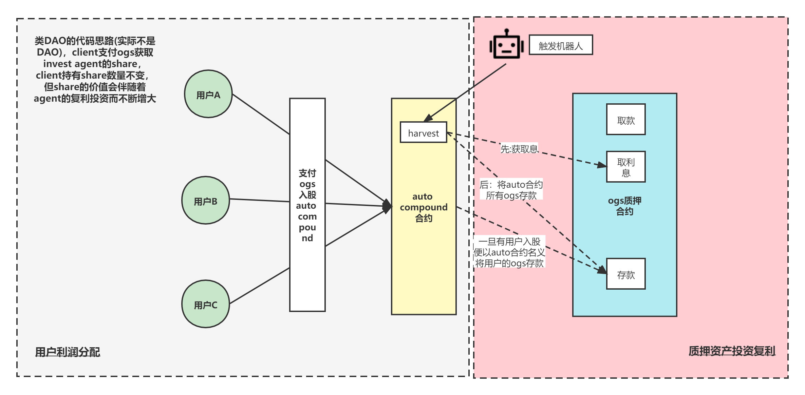
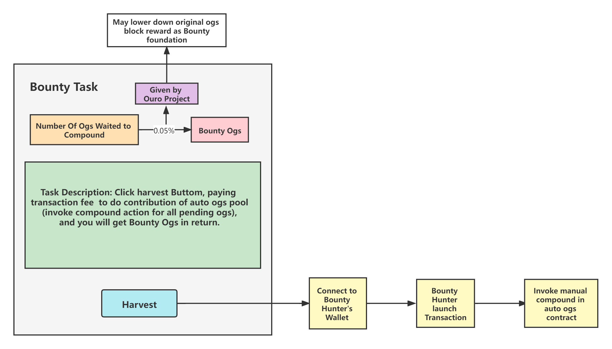

# Ouro Auto Compound

[中文文档](./README.md)

#### Code Overview (Using the Same Auto Compound Solution as Pancake)
1. Separate the code logic for compounding staked assets from that for distributing profits to users.

2. `lp_stacking.sol` deploys the OGS staking pool, and `auto_ogs.sol` connects to this staking pool.

3. Only `Auto_ogs.sol` is newly added. [`library.sol`, `lp_stacking.sol`, and `ogs.sol` all reuse the code from the Ouro source repository.]

   

   **Figure 1. Overall Design of Version 2 (Using the Pancake Auto Compound Approach)**

4. As shown in Figure 1, the overall design of Version 2 follows the Pancake Auto Compound model. `auto_ogs.sol` acts as an investment agent, while users participating in Auto Compound act as clients.

   **Compounding Staked Assets:** The agent receives OGS from clients, pools their OGS together, and stakes it in the OGS staking pool under the agent's name. The agent periodically reinvests the rewards (compounds them), which requires a bot to trigger the `harvest` function in `auto_ogs.sol` at regular intervals.

   **User Profit Distribution:** When the agent receives OGS from a client, it allocates shares to the client for accounting purposes. The number of shares held by each client increases only when the client deposits additional OGS with the agent through the Auto Pool; otherwise, the client's share count remains unchanged. Shares can be understood as equal portions of the agent's total invested principal and returns, divided according to the current total number of shares. When a client joins, the deposited OGS is exchanged for a corresponding number of shares based on the value of each share at that time. When a client withdraws, the number of shares available to the client has not changed, but the value of each share has changed. The current share value is calculated as follows (corresponding to the `getOgsPerAgentShare()` interface in `auto_ogs.sol`):

   OgsPerAgentShare = balanceOfAgentInvestment / totalShareNum

5. The detailed code logic is explained in the comments in `Auto_ogs.sol`.

#### Introduction to the Compound Trigger Mechanism

- Establish an incentive mechanism to encourage community users to help trigger compounding. (**Note: Users who help trigger compounding are not necessarily staking participants; these users can be regarded as Bounty Hunters.**)

**Bounty:**

<u>Display in real time the amount of OGS, M, currently awaiting compounding in the Auto OGS Pool, and offer OGS equivalent to *0.05% × M* as the bounty (supported by a bounty fund provided by the Ouro Project).</u>

*The block reward in Auto OGS can be reduced, with part of the block reward allocated to the bounty fund.*

**Bounty Task:**

<u>The bounty task is for a user to initiate a transaction that triggers the `harvest` function in the Auto OGS contract and pay the transaction fee.</u>

**Incentive:**

<u>When the accumulated bounty becomes more valuable than the cost of completing the bounty task, a Bounty Hunter will undertake the task.</u>
